<div align="center">

# 4-DOF Industrial Robot Arm: Design, Kinematics, Dynamics & Motion Planning

**Industrial Robotics (062092) · Politecnico di Milano · A.Y. 2025/26**
School of Industrial and Information Engineering, M.Sc. Mechanical Engineering

*Simone Bucci · Thomas Monaco · Erwin Novicio*


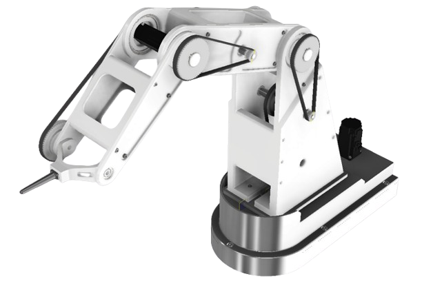

</div>

---

## Table of contents

1. [Overview](#1-overview)
2. [Robot specifications](#2-robot-specifications)
3. [Task definition](#3-task-definition)
4. [Kinematics](#4-kinematics)
5. [Workspace analysis](#5-workspace-analysis)
6. [Motion planning](#6-motion-planning)
7. [Dynamic analysis](#7-dynamic-analysis)
8. [Motor & transmission sizing](#8-motor--transmission-sizing)
9. [Kinetostatic performance (robot quality)](#9-kinetostatic-performance-robot-quality)
10. [Mechanical design (CAD)](#10-mechanical-design-cad)
11. [Benchmark on an industrial robot: Epson C4](#11-benchmark-on-an-industrial-robot-epson-c4)
12. [Key results](#12-key-results)
13. [Lessons learned & future work](#13-lessons-learned--future-work)

---

## 1. Overview

This project covers the **complete design workflow of a 4-degree-of-freedom articulated robot arm**, from the task specification to a manufacturable mechanical design:

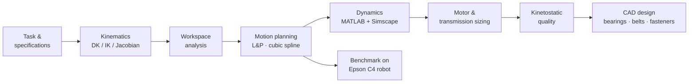

The arm has an **RRRR** architecture: a base yaw joint (Joint 1) followed by three parallel pitch joints (Joints 2–4) that place and orient the end-effector in a vertical plane. All joints are driven through **timing belt transmissions** with motors mounted close to the base to keep the moving inertia low.

| Tool | Used for |
|---|---|
| **MATLAB** | Kinematics, workspace, trajectory generation, numerical dynamics, motor sizing, manipulability |
| **Simscape Multibody** | Independent dynamic validation of the joint torques, 3D animation |
| **CAD** | Parts, assemblies, exploded views, section views and technical drawings |
| **Epson RC+** | Programming, simulating and logging the same task on a 6-axis industrial robot |

---

## 2. Robot specifications

<p align="center">
  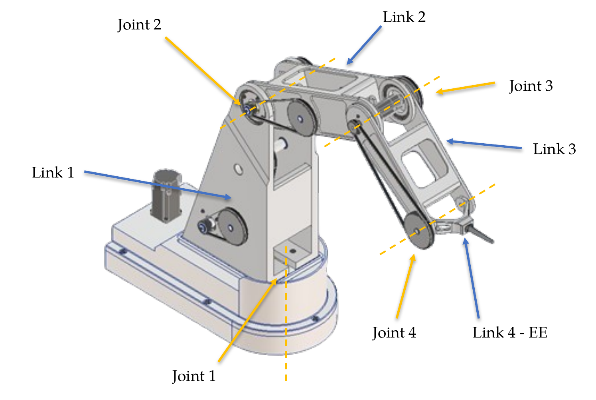
</p>

- **Materials:** arms in **ABS plastic**; base and shafts in **aluminium**
- **Maximum reach:** **870 mm** ($L_2 + L_3 + L_4$)

| Link | Length [mm] | Mass [kg] | Joint | Range [deg] |
|:---:|:---:|:---:|:---:|:---:|
| Link 1 ($L_1$) | 500 | 13.74 | Joint 1 | $-40^\circ \div 40^\circ$ |
| Link 2 ($L_2$) | 400 | 4.51 | Joint 2 | $-52^\circ \div 232^\circ$ |
| Link 3 ($L_3$) | 300 | 2.18 | Joint 3 | $-112^\circ \div 112^\circ$ |
| Link 4 ($L_4$) – EE | 170 | 0.43 | Joint 4 | $-120^\circ \div 120^\circ$ |

<p align="center">
  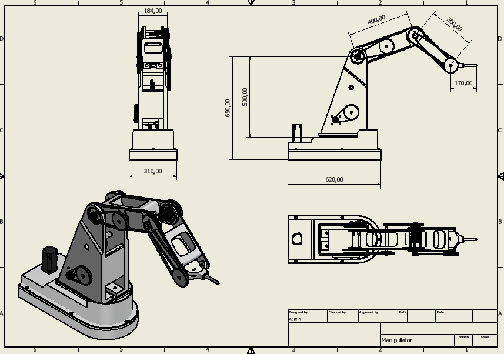
  <br><em>General arrangement drawing with the main dimensions.</em>
</p>

---

## 3. Task definition

The robot must move its end-effector along **two trajectories** defined around a helmet-shaped workpiece:

- **Trajectory 1:** planar path made of a **linear** segment followed by a **circular-like** arc (points P0–P11);
- **Trajectory 2:** spatial (3D) path, again with linear and curved portions (points P12–P25).

<p align="center">
  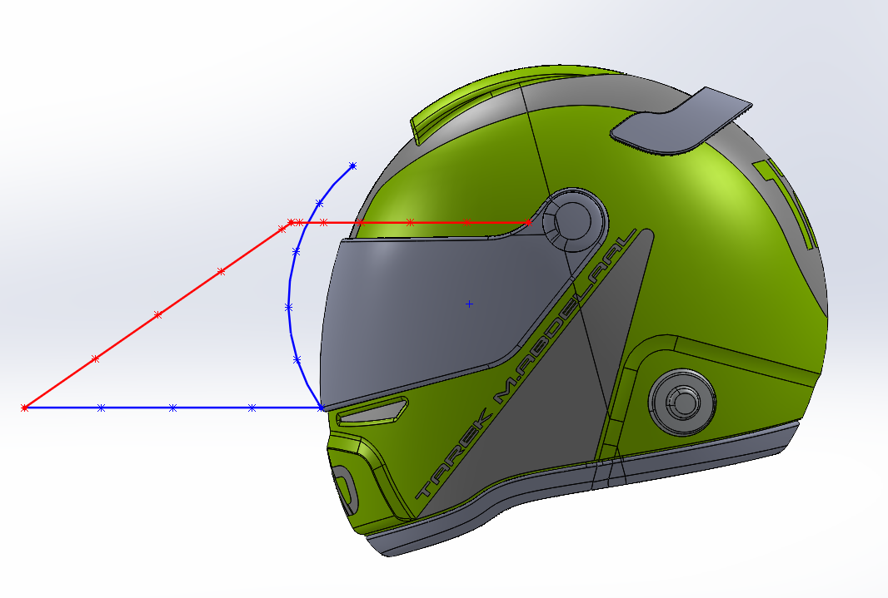
  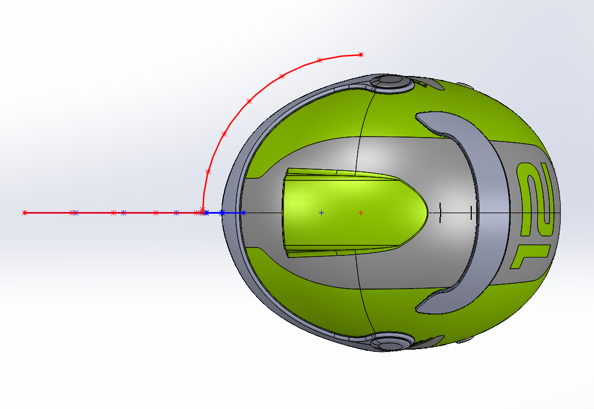
</p>

Both trajectories are **discretised into via-points**. Points are denser where the path changes direction sharply. For Trajectory 2, two auxiliary points are added close to the start and the end so that the spline has well-defined boundary conditions.

<p align="center">
  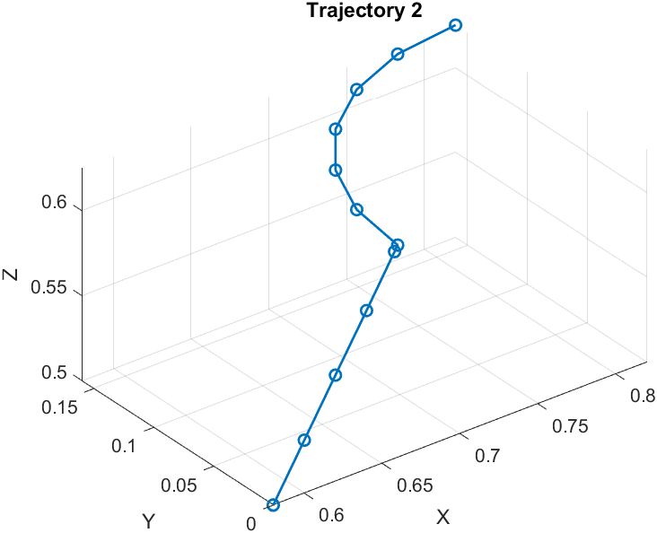
  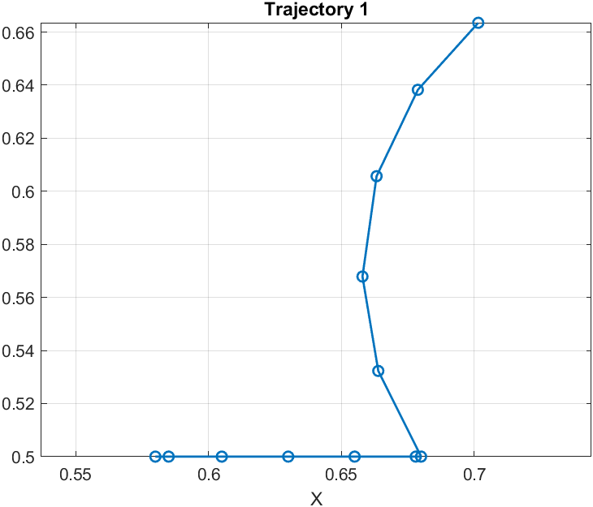
</p>

| Geometry | Trajectory 1 | Trajectory 2 |
|---|---|---|
| Linear | P0 – P5 | P12 – P17 |
| Circular | P6 – P11 | P18 – P25 |

---

## 4. Kinematics

### 4.1 Direct kinematics

Direct kinematics maps the joint space $Q = [q_1, q_2, q_3, q_4]^T$ to the workspace $S = [s_1, s_2, s_3]^T$ (end-effector position):

```math
S = F(Q) \;\Rightarrow\;
\begin{cases}
s_1 = \big(l_2\cos q_2 + l_3\cos(q_2+q_3) + l_4\cos(q_2+q_3+q_4)\big)\cos q_1 \\[2pt]
s_2 = \big(l_2\cos q_2 + l_3\cos(q_2+q_3) + l_4\cos(q_2+q_3+q_4)\big)\sin q_1 \\[2pt]
s_3 = l_1 + l_2\sin q_2 + l_3\sin(q_2+q_3) + l_4\sin(q_2+q_3+q_4)
\end{cases}
```

The end-effector orientation in the vertical plane is $\Phi = q_2 + q_3 + q_4$.

### 4.2 Inverse kinematics

Because the robot has 4 joints and the position task has 3 coordinates, the **approach angle $\Phi$** of the end-effector is also prescribed. That makes the problem square and lets it be solved in closed form via the **wrist point** $(X, Y, Z)$:

```math
\begin{aligned}
q_1 &= \operatorname{atan2}(s_2,\ s_1) \\
X &= s_1 - L_4\cos\Phi\cos q_1,\qquad
Y = s_2 - L_4\cos\Phi\sin q_1,\qquad
Z = s_3 - L_4\sin\Phi
\end{aligned}
```

With $r = \sqrt{X^2+Y^2}$ and $z = Z - L_1$, the planar 2-link sub-problem gives:

```math
\begin{aligned}
q_3 &= \pm\arccos\!\left(\frac{r^2 + z^2 - L_2^2 - L_3^2}{2L_2L_3}\right) \\
q_2 &= \operatorname{atan2}(z,\ r) - \operatorname{atan2}\!\big(L_3\sin q_3,\ L_2 + L_3\cos q_3\big) \\
q_4 &= \Phi - q_2 - q_3
\end{aligned}
```

The sign of $q_3$ selects the elbow configuration. The **elbow-up** solution is used, and the opposite configuration is avoided because it would interfere with the base and the workpiece:

<p align="center">
  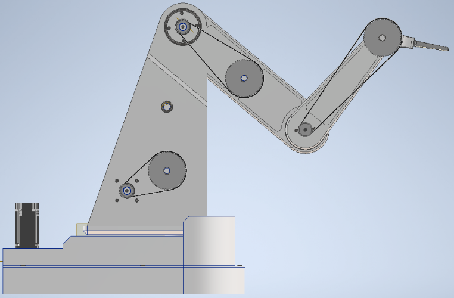
  &nbsp;&nbsp;
  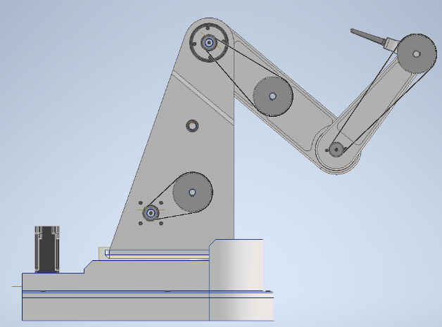
  <br><em>Left: chosen configuration. Right: configuration to be avoided.</em>
</p>

### 4.3 Jacobian

The position Jacobian $J \in \mathbb{R}^{3\times4}$, $\dot S = J(Q)\,\dot Q$, is

```math
J = \frac{\partial F}{\partial Q} =
\begin{bmatrix}
\dfrac{\partial F_1}{\partial q_1} & \dfrac{\partial F_1}{\partial q_2} & \dfrac{\partial F_1}{\partial q_3} & \dfrac{\partial F_1}{\partial q_4}\\[6pt]
\dfrac{\partial F_2}{\partial q_1} & \dfrac{\partial F_2}{\partial q_2} & \dfrac{\partial F_2}{\partial q_3} & \dfrac{\partial F_2}{\partial q_4}\\[6pt]
\dfrac{\partial F_3}{\partial q_1} & \dfrac{\partial F_3}{\partial q_2} & \dfrac{\partial F_3}{\partial q_3} & \dfrac{\partial F_3}{\partial q_4}
\end{bmatrix}
```

Written out explicitly, with $c_{ij\dots} = \cos(q_i+q_j+\dots)$ and $s_{ij\dots} = \sin(q_i+q_j+\dots)$:

```math
J =
\begin{bmatrix}
-r\,s_1 & -h_2\,c_1 & -h_3\,c_1 & -h_4\,c_1 \\
\phantom{-}r\,c_1 & -h_2\,s_1 & -h_3\,s_1 & -h_4\,s_1 \\
0 & r & r_3 & r_4
\end{bmatrix},
\qquad
\begin{aligned}
r   &= l_2c_2 + l_3c_{23} + l_4c_{234}, & h_2 &= l_2s_2 + l_3s_{23} + l_4s_{234}\\
r_3 &= l_3c_{23} + l_4c_{234},          & h_3 &= l_3s_{23} + l_4s_{234}\\
r_4 &= l_4c_{234},                      & h_4 &= l_4s_{234}
\end{aligned}
```

The Jacobian is used for the dynamic model (Section 7) and the kinetostatic quality assessment (Section 9).

---

## 5. Workspace analysis

Two methods were used to compute the workspace, and they give the same result:

1. **Direct kinematics sweep:** joint ranges are swept on a grid and the external envelope is meshed. The figure compares the *theoretical* workspace (no joint limits) with the *effective* one (with the joint ranges from Section 2).
2. **Monte Carlo method:** random joint configurations are sampled within the joint limits and mapped through $F(Q)$.

<p align="center">
  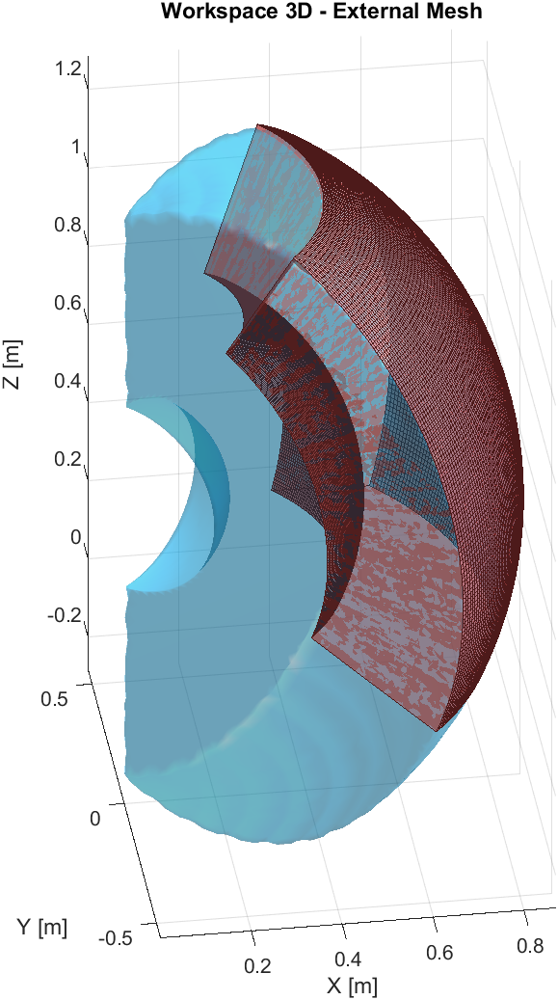
  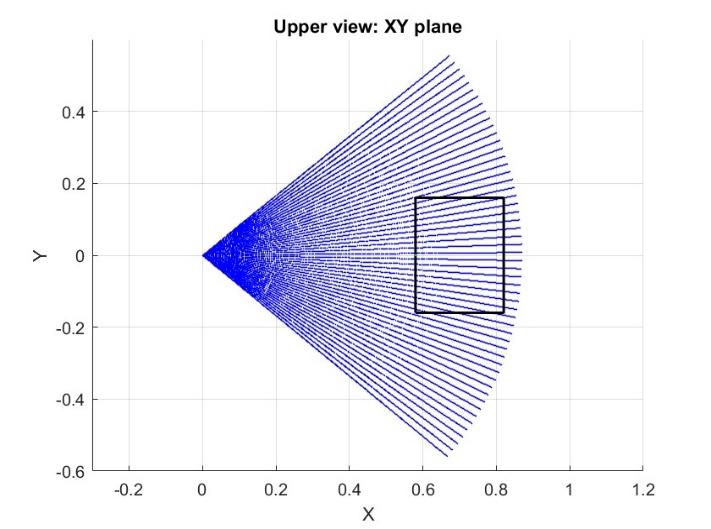
  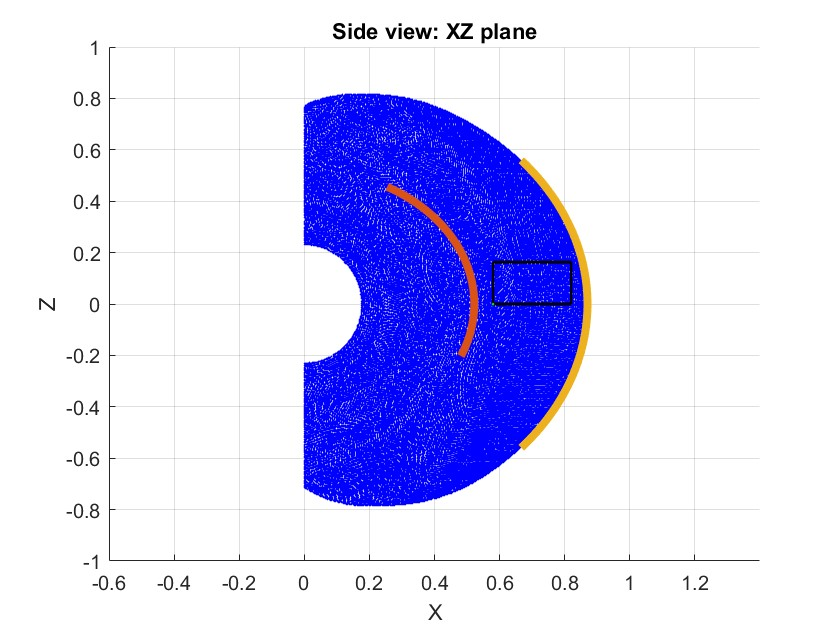
  <br><em>Left: 3D workspace from direct kinematics (theoretical vs. effective). Centre and right: Monte Carlo workspace in the XY and XZ planes, with the task trajectories highlighted.</em>
</p>

Both trajectories lie well inside the reachable workspace.

---

## 6. Motion planning

### 6.1 Joint limits and synchronisation

| Joint | Max angular velocity [rad/s] | Max angular acc./dec. [rad/s²] |
|:---:|:---:|:---:|
| 1 | 100 | 4 |
| 2 | 100 | 3 |
| 3 | 100 | 4 |
| 4 | 200 | 5 |

**Synchronisation:** for every segment between two consecutive via-points, each joint's motion time is computed on its own. The segment time is then set to the **largest of the four**:

```math
T_k = \max_{i=1..4} T_{k,i}
```

All joints start and end each segment together, so the end-effector follows the intended path.

### 6.2 Trajectory 1: Lines & Parabolas (trapezoidal velocity)

Each segment uses a constant-acceleration blend (parabola), a constant-velocity cruise (line), and a constant-deceleration blend. For a joint displacement $\Delta q$ with limits $\dot q_{max}$ and $\ddot q_{max}$:

```math
t_a = \frac{\dot q_{max}}{\ddot q_{max}},\qquad
T =
\begin{cases}
\dfrac{|\Delta q|}{\dot q_{max}} + \dfrac{\dot q_{max}}{\ddot q_{max}} & \text{if } |\Delta q| > \dfrac{\dot q_{max}^2}{\ddot q_{max}} \quad \text{(trapezoidal)}\\[10pt]
2\sqrt{\dfrac{|\Delta q|}{\ddot q_{max}}} & \text{otherwise} \quad \text{(triangular)}
\end{cases}
```

<p align="center">
  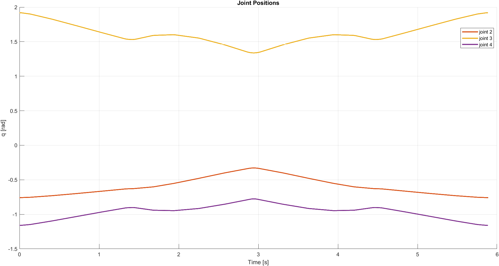
  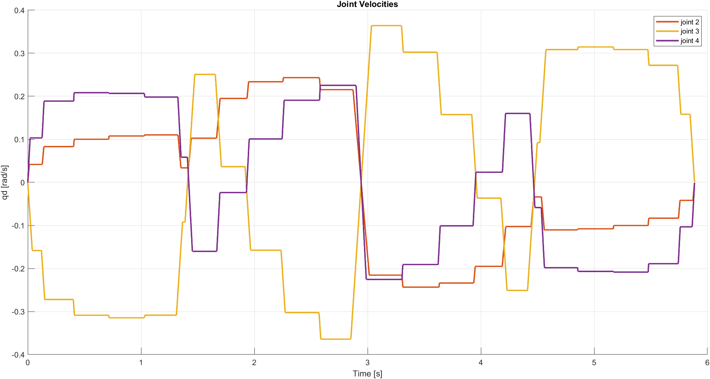
  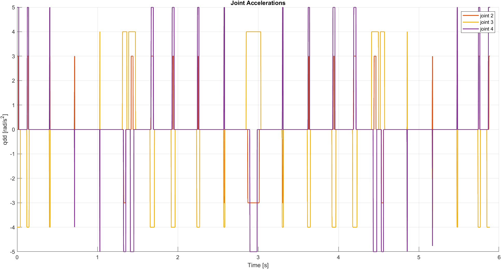
  <br><em>Trajectory 1: joint position, velocity and acceleration.</em>
</p>

**Execution time, Trajectory 1: 5.887 s**

### 6.3 Trajectory 2: Cubic spline

The 3D path is interpolated with a **cubic spline**: piecewise third-order polynomials with continuous position, velocity and acceleration ($C^2$) at every via-point.

```math
q(t) = a_{0,k} + a_{1,k}(t-t_k) + a_{2,k}(t-t_k)^2 + a_{3,k}(t-t_k)^3,\qquad t\in[t_k,\,t_{k+1}]
```

The auxiliary points near the start and the end of the path enforce rest-to-rest motion.

<p align="center">
  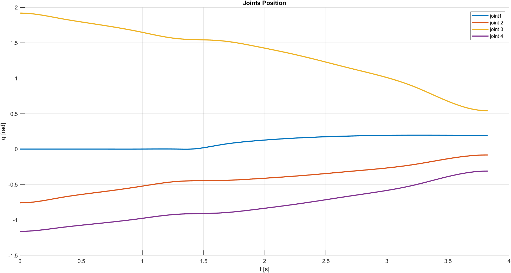
  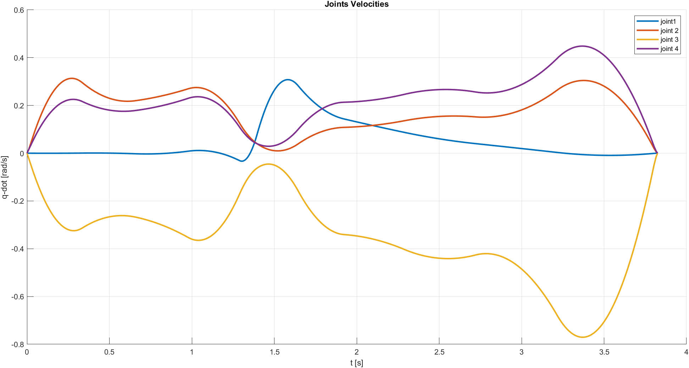
  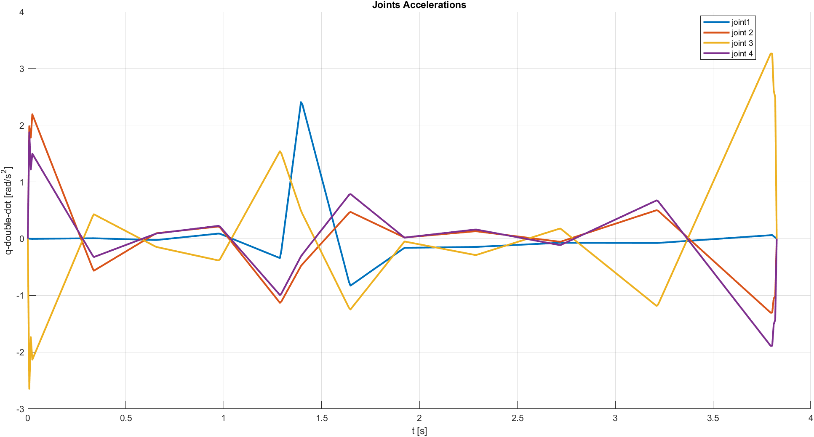
  <br><em>Trajectory 2: joint position, velocity and acceleration.</em>
</p>

**Execution time, Trajectory 2: 3.825 s**

### 6.4 Verification with direct kinematics

The planned joint trajectories are fed back through $F(Q)$ to check that the end-effector follows the desired paths. Start and end points are marked in red and green.

<p align="center">
  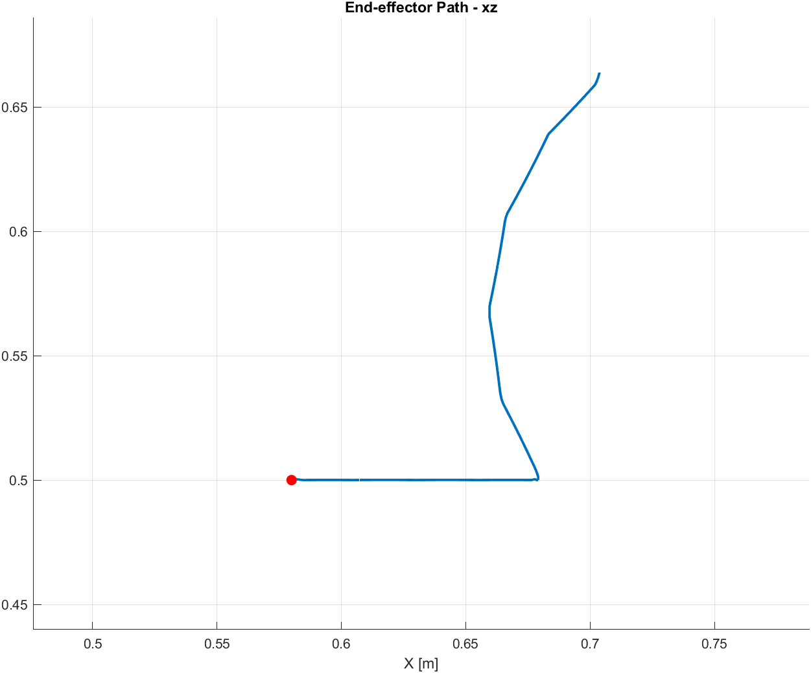
  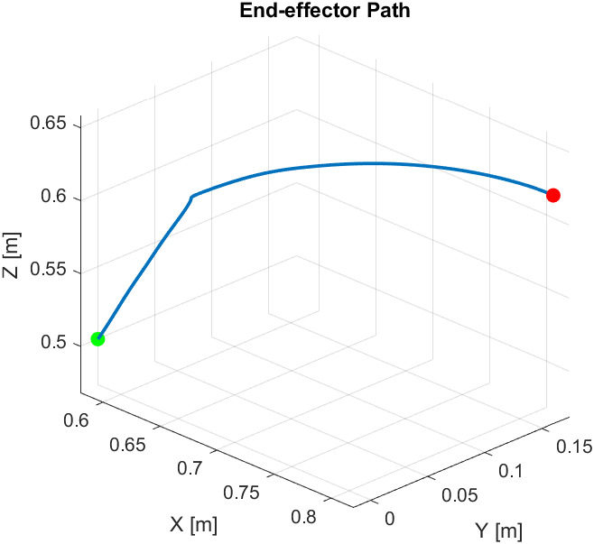
  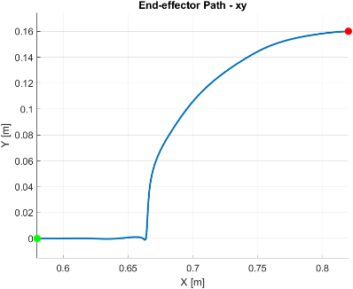
  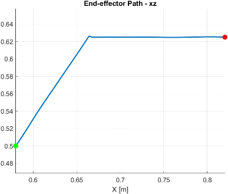
</p>

---

## 7. Dynamic analysis

### 7.1 MATLAB model: virtual work / D'Alembert approach

Joint torques are computed with an **extended kinematics** formulation. Every mass and inertia of the robot is described by its own "extended" coordinate. The inputs are:

- Mass matrix: $\mathbf{M} = \operatorname{diag}(m, m, m, m_4, m_4, m_4, J_4, m_3, m_3, m_3, J_3, m_2, m_2, m_2, J_2, J_1) \in \mathbb{R}^{16\times16}$, where $m$ is the payload
- Link lengths $\mathbf{L} \in \mathbb{R}^{4\times1}$ and centre-of-mass distances $\mathbf{G} \in \mathbb{R}^{4\times1}$
- $Q,\ \dot Q,\ \ddot Q$ from motion planning
- External (gravity) forces:
  $\mathbf{F}_{ext}^T = [0,\,0,\,-mg,\,0,\,0,\,-m_4g,\,0,\,0,\,0,\,-m_3g,\,0,\,0,\,0,\,-m_2g,\,0,\,0]$
- Extended forward kinematics $S_e(Q, L, G) \in \mathbb{R}^{16\times1}$

<details>
<summary><b>Extended forward kinematics S<sub>e</sub> (click to expand)</b></summary>

```math
\begin{aligned}
S_e(1) &= \big(l_2\cos\theta_2 + l_3\cos(\theta_2+\theta_3) + l_4\cos(\theta_2+\theta_3+\theta_4)\big)\cos\theta_1 \\
S_e(2) &= \big(l_2\cos\theta_2 + l_3\cos(\theta_2+\theta_3) + l_4\cos(\theta_2+\theta_3+\theta_4)\big)\sin\theta_1 \\
S_e(3) &= l_2\sin\theta_2 + l_3\sin(\theta_2+\theta_3) + l_4\sin(\theta_2+\theta_3+\theta_4) + l_1 \\
S_e(4) &= \big(l_2\cos\theta_2 + l_3\cos(\theta_2+\theta_3) + g_4\cos(\theta_2+\theta_3+\theta_4)\big)\cos\theta_1 \\
S_e(5) &= \big(l_2\cos\theta_2 + l_3\cos(\theta_2+\theta_3) + g_4\cos(\theta_2+\theta_3+\theta_4)\big)\sin\theta_1 \\
S_e(6) &= l_2\sin\theta_2 + l_3\sin(\theta_2+\theta_3) + g_4\sin(\theta_2+\theta_3+\theta_4) + l_1 \\
S_e(7) &= \theta_2 + \theta_3 + \theta_4 \\
S_e(8) &= \big(l_2\cos\theta_2 + g_3\cos(\theta_2+\theta_3)\big)\cos\theta_1 \\
S_e(9) &= \big(l_2\cos\theta_2 + g_3\cos(\theta_2+\theta_3)\big)\sin\theta_1 \\
S_e(10) &= l_2\sin\theta_2 + g_3\sin(\theta_2+\theta_3) + l_1 \\
S_e(11) &= \theta_2 + \theta_3 \\
S_e(12) &= g_2\cos\theta_2\cos\theta_1 \\
S_e(13) &= g_2\cos\theta_2\sin\theta_1 \\
S_e(14) &= g_2\sin\theta_2 + l_1 \\
S_e(15) &= \theta_2 \\
S_e(16) &= \theta_1
\end{aligned}
```

Rows 1–3 give the payload position, rows 4–7 give the CoM position and orientation of link 4, rows 8–11 give link 3, rows 12–15 give link 2, and row 16 gives the base rotation.
</details>

The **extended Jacobian** and its **time derivative** are computed **numerically** with central finite differences:

```math
J_{:,j} = \frac{S_e(Q+\delta e_j) - S_e(Q-\delta e_j)}{2\delta},
\qquad
\dot J \approx \frac{J(Q + h\dot Q) - J(Q - h\dot Q)}{2h},
\qquad J,\ \dot J \in \mathbb{R}^{16\times4}
```

Then the joint torques follow from the principle of virtual work:

```math
\begin{aligned}
\ddot x &= \dot J(q,\dot q)\,\dot q + J(q)\,\ddot q &&\text{(extended accelerations)}\\
F_{si} &= -M\ddot x &&\text{(inertia forces)}\\
F_s &= F_{ext} + F_{si} &&\\
\tau &= -J(q)^T F_s &&\text{(joint torques)}
\end{aligned}
```

<p align="center">
  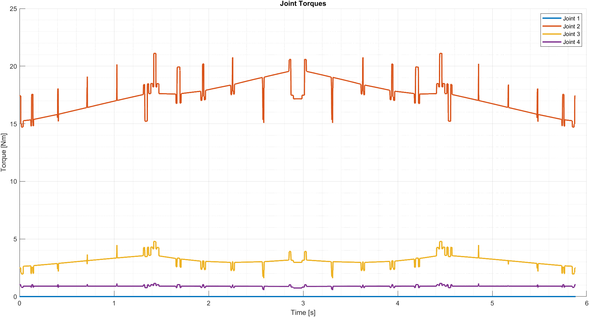
  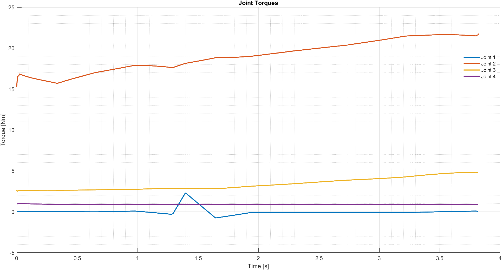
  <br><em>Joint torques: Trajectory 1 (left) and Trajectory 2 (right). Joint 2 carries the largest load because it supports the whole arm against gravity.</em>
</p>

### 7.2 Simscape Multibody validation

As an independent check, the robot was modelled in **Simscape Multibody** and driven by the same joint trajectories:

<p align="center">
  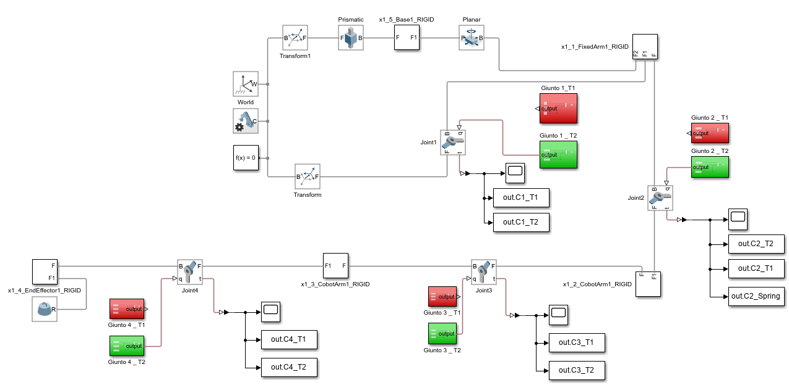
</p>

<p align="center">
  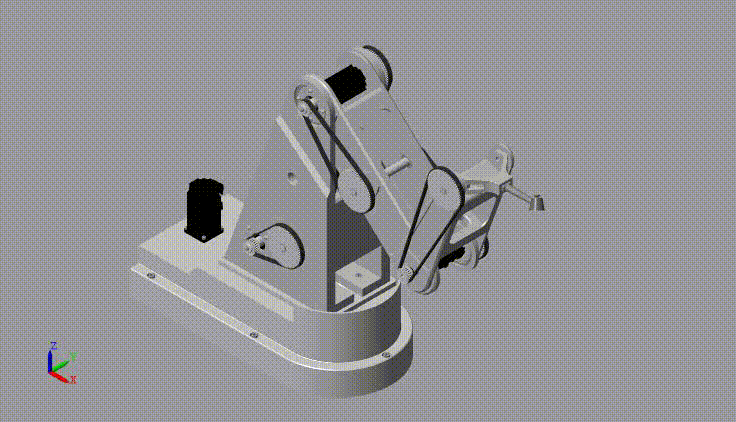
  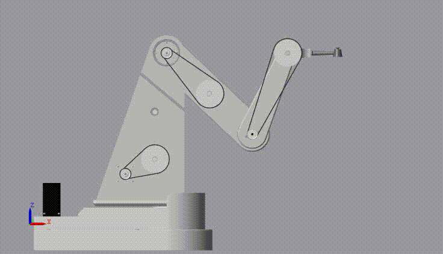
</p>

The Simscape torques (dashed) **match the MATLAB model** (solid) for both trajectories:

<p align="center">
  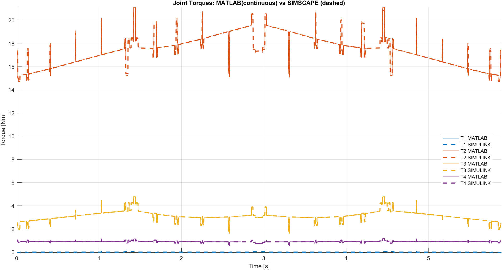
  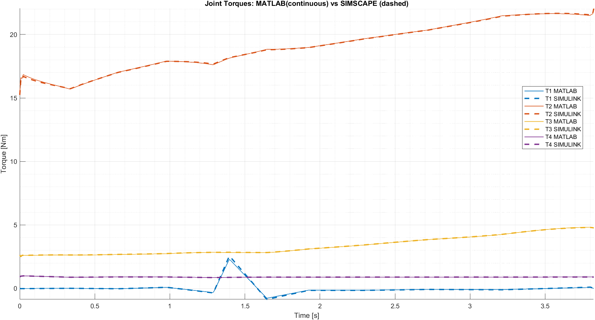
</p>

### 7.3 Effect of the payload

The analysis was repeated with **0 kg** (dashed) and **1 kg** (solid) payload:

<p align="center">
  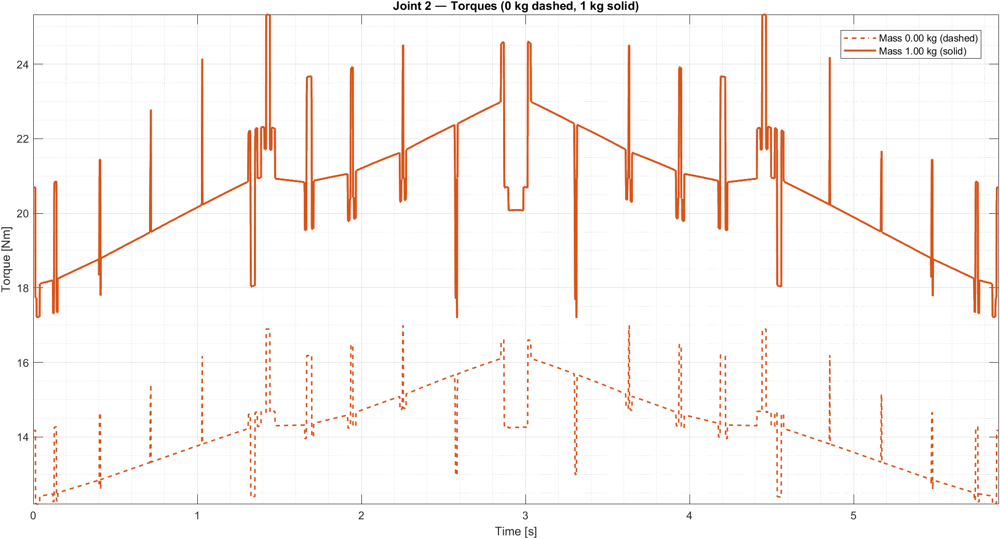
  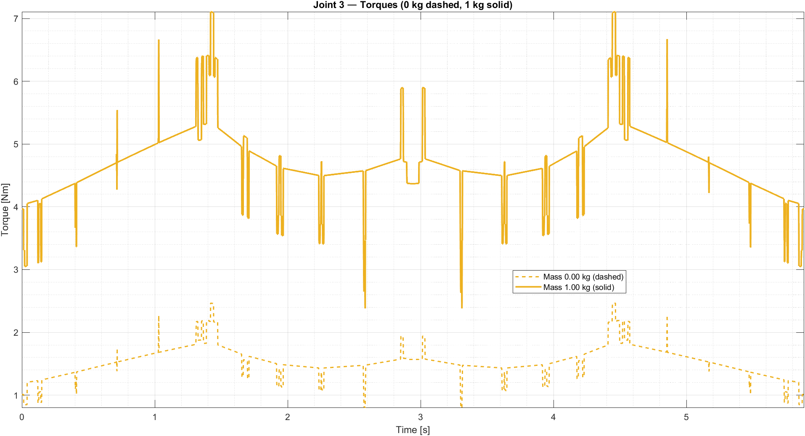
  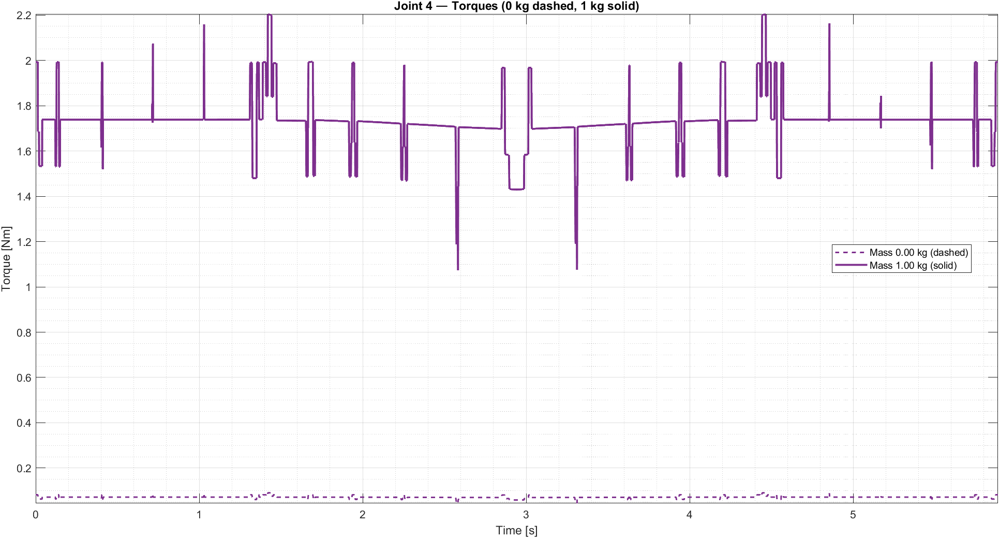
  <br><em>Trajectory 1: joints 2, 3, 4.</em>
</p>

<p align="center">
  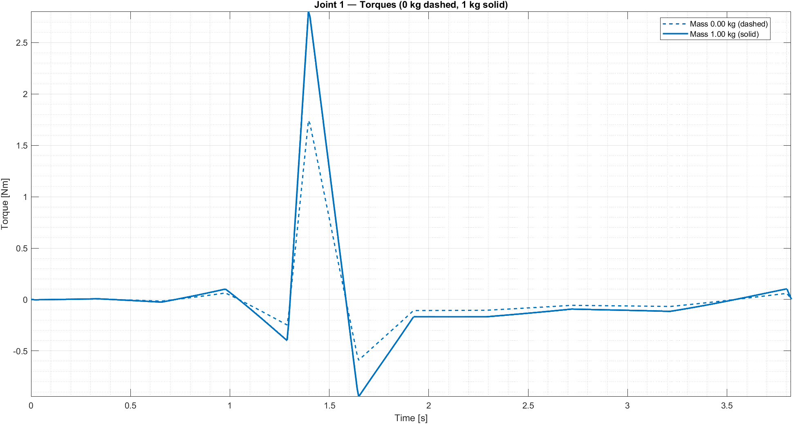
  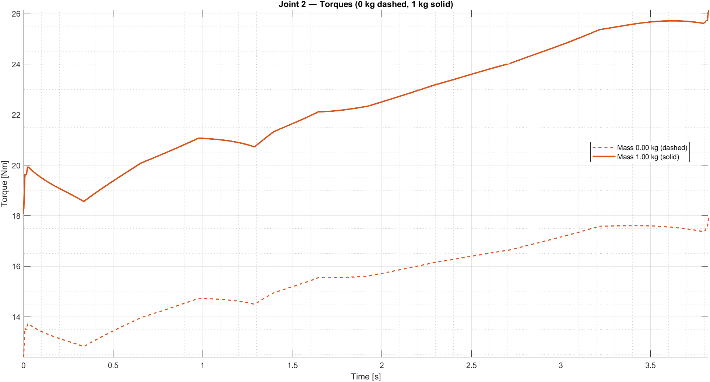
  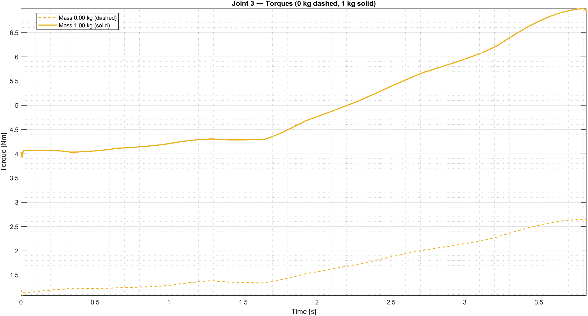
  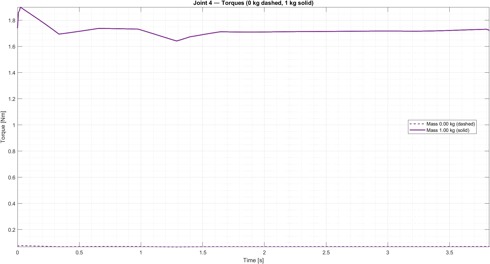
  <br><em>Trajectory 2: joints 1–4.</em>
</p>

---

## 8. Motor & transmission sizing

### 8.1 Method

For each joint, the following parameters are defined from the motor data ($C_n$ nominal torque, $J_m$ rotor inertia) and the load ($J_r$ reduced load inertia, $\ddot q$ load acceleration, $C_r$ resistant torque):

```math
\alpha = \frac{C_n^2}{J_m}\ \ \text{(accelerating factor)},
\qquad
\beta = 4\,J_r\,\ddot q_{rms}^2\ \ \text{(load factor)}
```

```math
\tau_{opt} = \sqrt{\frac{J_m\,\ddot q_{rms}}{C_{r,rms}}},
\qquad
\tau_{min,\,max} = \frac{\sqrt{J_m}\,\big(\sqrt{\alpha} \mp \sqrt{\alpha-\beta}\big)}{2\,J_r\,\ddot q_{rms}},
\qquad
\tau_{vel} = \frac{\dot q_{max}}{\dot q_{m,max}}
```

A motor–transmission pair is accepted when all three conditions hold:

| Nominal torque | Maximum torque | Transmission ratio range |
|:---:|:---:|:---:|
| $C_{m,n} > \tau\, C_{r,rms,max}$ | $C_{m,max} > \tau\, C_{max}$ | $\tau_{max} > \tau > \tau_{vel} > \tau_{min}$ |

Since $\alpha \gg \beta$ for every joint and trajectory (figure below), the bounds simplify to

```math
\sqrt{\alpha} - \sqrt{\alpha-\beta} \approx 0 \;\Rightarrow\; \tau_{min}\approx 0,
\qquad
\sqrt{\alpha} + \sqrt{\alpha-\beta} \approx 2\sqrt{\alpha} \;\Rightarrow\; \tau_{max}\approx \frac{C_n}{J_r\,\ddot q_{rms}}
```

This would also justify a quasi-static sizing (motor inertia $J_m \approx 0$). A **full dynamic sizing** was kept anyway, for more accurate results.

<p align="center">
  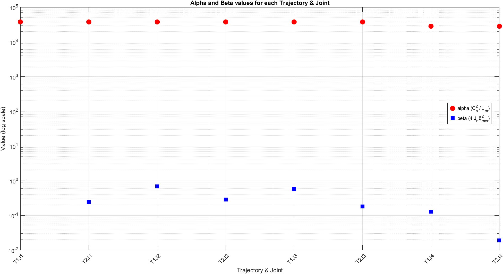
  <br><em>α (red) vs β (blue) for each joint and trajectory, log scale.</em>
</p>

### 8.2 Selected motors and transmissions

Motors come from the Mitsubishi Electric **HG-KR** servo series. Sizing was done for the **worst case, 1 kg payload**:

| Joint | Motor | $C_n$ / $C_{max}$ [Nm] | $\tau$ | $\tau\,C_{r,rms,max}$ (0 kg → 1 kg) | $\tau\,C_{max}$ (0 kg → 1 kg) | Result |
|:---:|:---:|:---:|:---:|:---:|:---:|:---:|
| 1 | HG-KR23B, 200 W | 0.64 / 1.9 | 0.5 | 0.2208 → **0.2671** | 1.2628 → **1.5283** | ✅ |
| 2 | HG-KR23B, 200 W | 0.64 / 1.9 | 0.02 | 0.3983 → **0.4703** | 0.4602 → **0.5455** | ✅ |
| 3 | HG-KR23B, 200 W | 0.64 / 1.9 | 0.11 | 0.3824 → **0.5694** | 0.5337 → **0.7815** | ✅ |
| 4 | HG-KR13B, 100 W | 0.32 / 0.95 | 0.33 | 0.1503 → **0.2887** | 0.1910 → **0.3669** | ✅ |

<p align="center">
  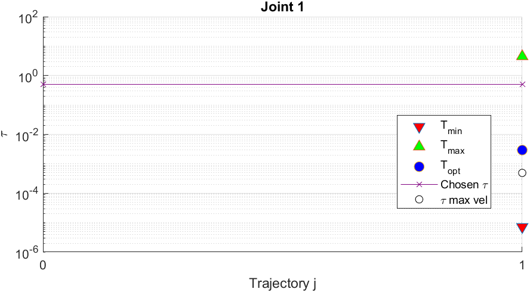
  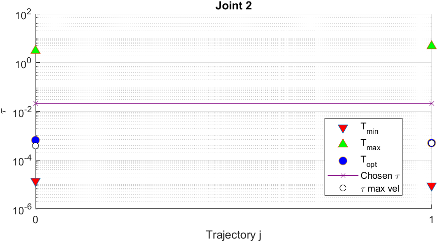
  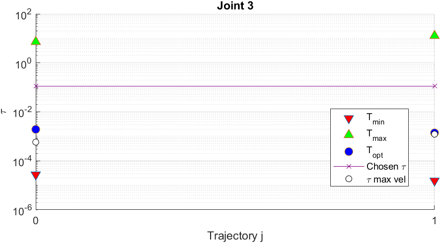
  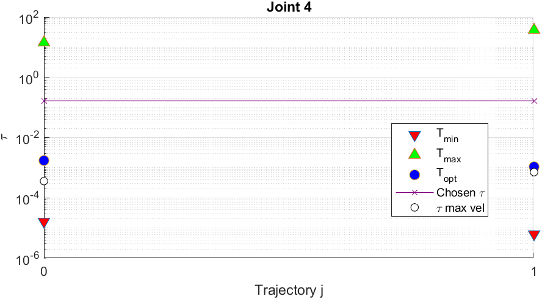
  <br><em>Feasible transmission-ratio range per joint (1 kg payload): τ<sub>min</sub> ▼, τ<sub>max</sub> ▲, τ<sub>opt</sub> ●, τ for max velocity ○ and the chosen τ (line).</em>
</p>

<details>
<summary>Sizing plots with no payload</summary>
<p align="center">
  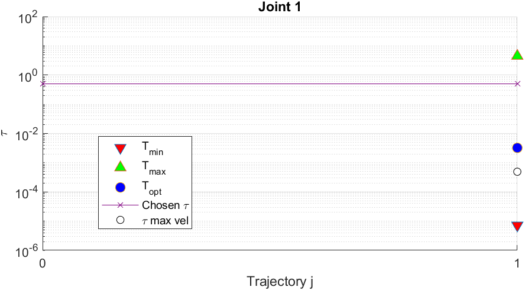
  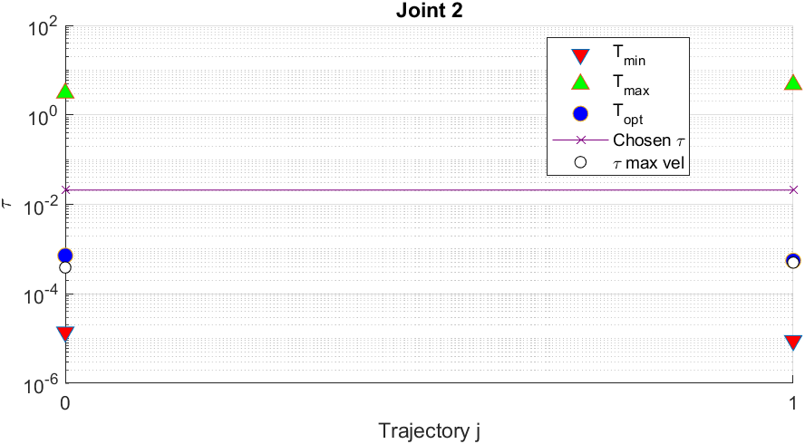
  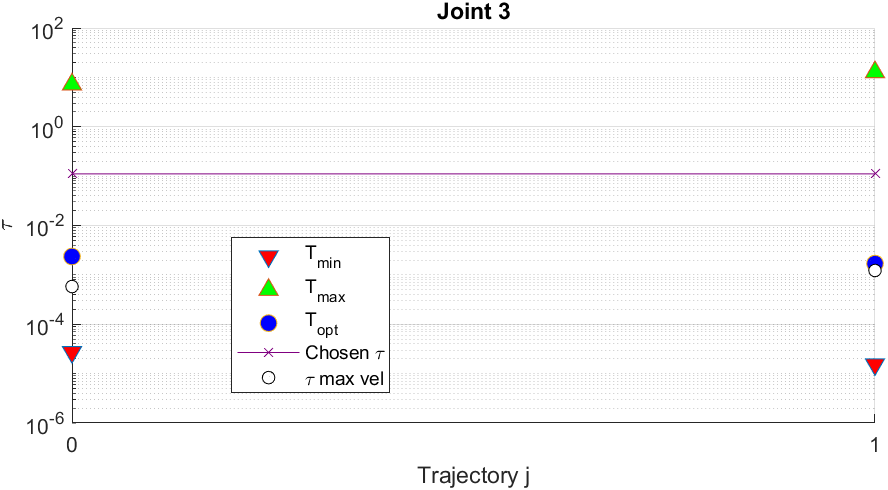
  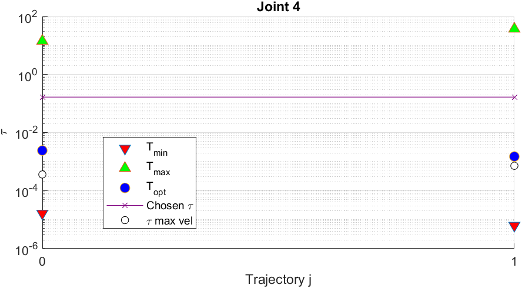
</p>
</details>

The ratios are achieved with **timing-belt stages**:

<p align="center">
  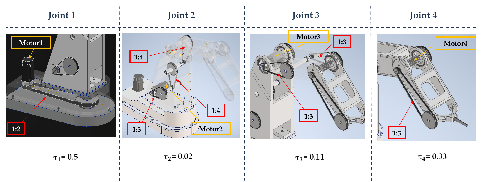
</p>

| Joint | Belt stages | Overall ratio |
|:---:|:---:|:---:|
| 1 | 1:2 | $\tau_1 = 0.5$ |
| 2 | 1:3 · 1:4 · 1:4 | $\tau_2 = 1/48 \approx 0.02$ |
| 3 | 1:3 · 1:3 | $\tau_3 = 1/9 \approx 0.11$ |
| 4 | 1:3 | $\tau_4 \approx 0.33$ |

### 8.3 Possible improvement: gravity-compensation spring

Joint 2 carries a large gravitational torque. Adding a **torsional spring of 0.6 Nm/deg** on that joint greatly reduces the RMS resistant torque, which allows a smaller motor or a less aggressive reduction:

| | With spring, Traj. 1 | With spring, Traj. 2 | Without spring, Traj. 1 | Without spring, Traj. 2 |
|---|:---:|:---:|:---:|:---:|
| $C_{r,rms}$ [Nm] | **6.17** | **9.30** | 17.48 | 19.12 |
| $\tau_{opt}$ | 0.00120 | 0.00079 | 0.00071 | 0.00055 |

That is a **≈65 % reduction** of $C_{r,rms}$ on Trajectory 1 and **≈51 %** on Trajectory 2.

<p align="center">
  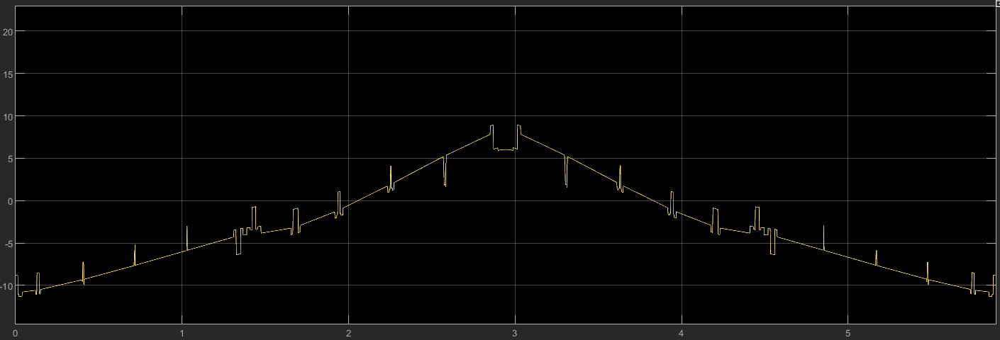
  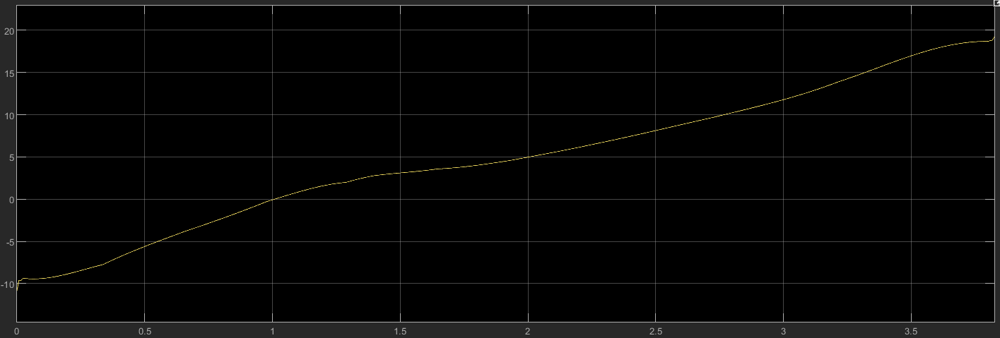
</p>

---

## 9. Kinetostatic performance (robot quality)

The quality of the robot along the task is evaluated with **velocity and force manipulability ellipsoids**.

**Kinetostatic duality:**
```math
F_q = -J^T F_s, \qquad \dot S = J\,\dot Q
```

Joint velocities and forces of **unit norm** ($\dot Q^T\dot Q = 1$, $F_q^TF_q = 1$) map into the ellipsoids

```math
\dot S^T (JJ^T)^{-1}\dot S = 1 \quad\text{(velocity ellipsoid)},
\qquad
F_s^T (JJ^T) F_s = 1 \quad\text{(force ellipsoid)}
```

The **manipulability matrix** is $M = JJ^T$, and the ellipsoid semi-axes are its singular values, $\sigma_i = \sqrt{\lambda_i(JJ^T)}$. The two ellipsoids are orthogonal duals: directions with high velocity transmission have low force transmission, and vice versa.

<p align="center">
  
  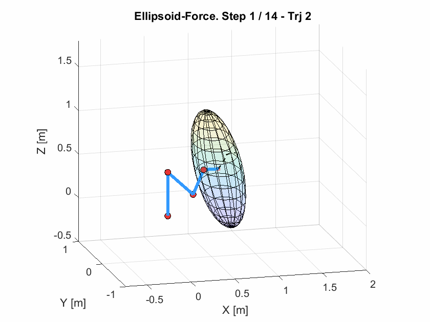
  <br>
  
  
  <br><em>Force (top) and velocity (bottom) ellipsoids along Trajectory 1 (left) and Trajectory 2 (right).</em>
</p>

The quality index is the **inverse condition number**:

```math
C_i = \frac{\sigma_{min}}{\sigma_{max}}, \qquad C_i \in [0, 1]
```

$C_i = 1$ means an isotropic configuration and $C_i \to 0$ means a singularity.

<p align="center">
  
  
</p>

- **Trajectory 1:** $C_i$ stays above the 0.2 reference limit across the whole path (≈0.22–0.35).
- **Trajectory 2:** good conditioning for most of the path. In the last steps the arm approaches full extension and $C_i$ falls below 0.2, so those poses are close to a singularity.

---

## 10. Mechanical design (CAD)

### 10.1 Assemblies

<p align="center">
  
  
  <br><em>Exploded views: forearm / end-effector and arm sub-assemblies.</em>
</p>

<p align="center">
  
  
  <br><em>Shoulder (Link 1) sub-assembly with detail views.</em>
</p>

<p align="center">
  
  
  <br><em>Base sub-assembly and motor installation.</em>
</p>

### 10.2 Bearing configurations

- **Base shaft (Joint 1):** a pair of **back-to-back angular-contact ball bearings**, which carry both the radial loads and the axial load from the weight of the whole arm.

<p align="center">
  
</p>

- **Other joints and shafts:** pairs of **deep-groove radial ball bearings**. Angular-contact bearings would be the textbook choice, but axial loads here are negligible, so the simpler arrangement was preferred.

<p align="center">
  
  
</p>

<p align="center">
  
  <br><em>Section views with all bearing locations highlighted.</em>
</p>

### 10.3 Design details

**Pulley fastening.** The first design fixed pulleys with **keys**. Keys perform poorly under frequent reversal of rotation and introduce backlash, so they were replaced by **clamping (friction) hubs**.

<p align="center">
  
  &nbsp;➜&nbsp;
  
</p>

**Threads in plastic.** Tapping threads directly into ABS wears out quickly, so **M6 heat-set threaded inserts** are used wherever a screw goes into a plastic part.

<p align="center">
  
</p>

---

## 11. Benchmark on an industrial robot: Epson C4

The same two tasks were programmed on a commercial **6-axis Epson C4 (C4-A901)** articulated robot (900 mm reach, 4 kg payload) to compare the results with an industrial controller.

<p align="center">
  
</p>

### 11.1 Setting speed and acceleration

To make the comparison fair, Epson's TCP speed and acceleration were set from the **average** joint quantities of the custom robot's trajectories:

```math
\bar q_i = \frac{1}{N}\sum_{k=1}^{N} q_{k},
\qquad
\bar{\dot q}_i = \frac{1}{T}\int_{t_0}^{t_f} |\dot q|\,dt,
\qquad
\bar{\ddot q}_i = \frac{1}{T}\int_{t_0}^{t_f} |\ddot q|\,dt,
\qquad i = 1..4
```

```math
\bar{\dot S} = J_m\,\bar{\dot Q},
\qquad
\bar{\ddot S} = \dot J_m\,\bar{\dot Q} + J_m\,\bar{\ddot Q},
\qquad
\|\bar{\dot S}\|_2 = \sqrt{\bar{\dot S}_x^2 + \bar{\dot S}_y^2 + \bar{\dot S}_z^2}
```

### 11.2 Programming and simulation

The tasks were written in **SPEL+** (Epson RC+). Linear segments use `Move` and circular segments use `Curve` / `CVMove` through the teaching points. A custom **data-logger function** records elapsed time, TCP position, TCP speed and joint angles to a text file.

<p align="center">
  
  
  <br><em>Trajectory 1: 6.645 s · Trajectory 2: 4.767 s</em>
</p>

### 11.3 Logged results

<details open>
<summary><b>TCP position</b></summary>
<p align="center">
   <br>
   
</p>
</details>

<details>
<summary><b>TCP speed and acceleration</b></summary>
<p align="center">
   <br>
   
</p>
</details>

<details>
<summary><b>Joint position, velocity and acceleration (raw vs filtered)</b></summary>
<p align="center">
   <br>
   <br>
   
</p>
</details>

The joint accelerations were obtained by differentiating the logged positions, which amplifies sampling noise. A low-pass filter (red) recovers the underlying trend.

---

## 12. Key results

| Quantity | Trajectory 1 | Trajectory 2 |
|---|:---:|:---:|
| Interpolation method | Lines & Parabolas | Cubic spline |
| Execution time, custom 4-DOF robot | **5.887 s** | **3.825 s** |
| Execution time, Epson C4 | 6.645 s | 4.767 s |
| Min. inverse condition number | ≈ 0.22 | < 0.1 (end of path) |
| $C_{r,rms}$ on Joint 2, without → with spring | 17.48 → 6.17 Nm | 19.12 → 9.30 Nm |

- Closed-form IK and numerical extended-Jacobian dynamics, **validated against Simscape Multibody**
- All four motor–transmission pairs **pass the nominal and peak torque checks** with a 1 kg payload
- A complete CAD design with bearing selection, belt transmissions and plastic-specific fastening solutions

---

## 13. Lessons learned & future work

- **Gravity compensation:** a 0.6 Nm/deg torsional spring on Joint 2 roughly halves the RMS torque and would allow a smaller motor.
- **Trajectory 2 conditioning:** the final poses approach a singularity. Moving the task slightly closer to the base, or re-planning the approach angle $\Phi$, would keep $C_i > 0.2$.
- **Bearings:** if axial loads grow, for example with a heavier tool, the deep-groove pairs could be upgraded to angular-contact pairs.
- **Smoother profiles:** using quintic (jerk-limited) profiles instead of Lines & Parabolas would remove the acceleration steps visible in Trajectory 1.

---

<div align="center">

*Group project for the course **Industrial Robotics (062092)**, Politecnico di Milano, A.Y. 2025/26.*

</div>
